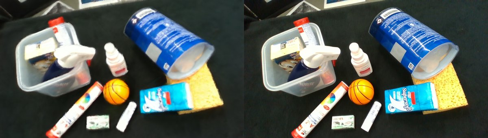
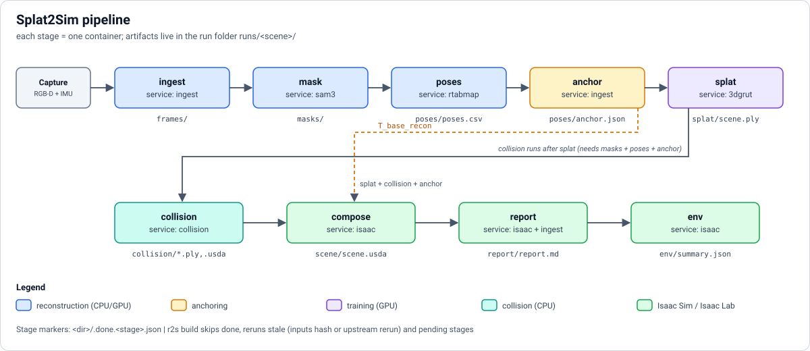
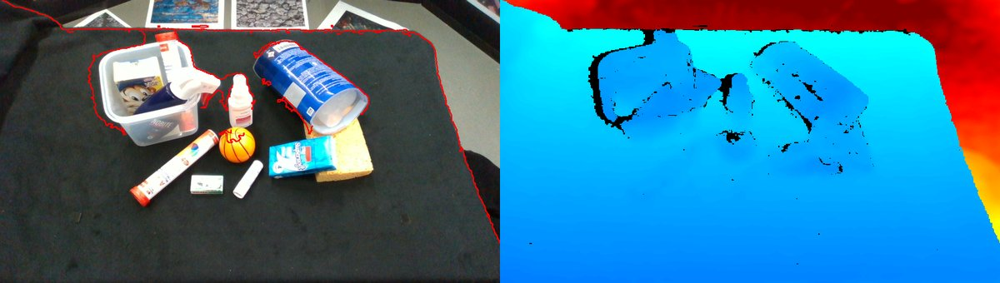
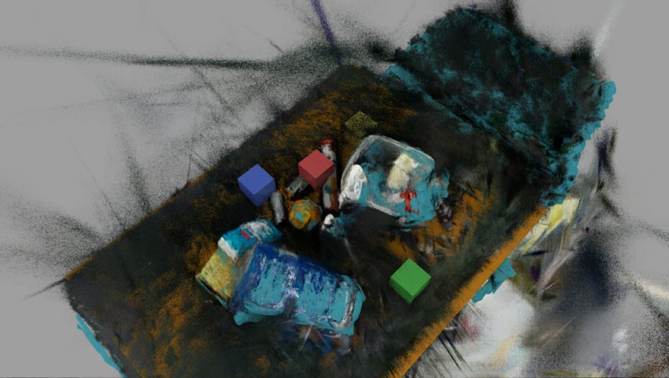
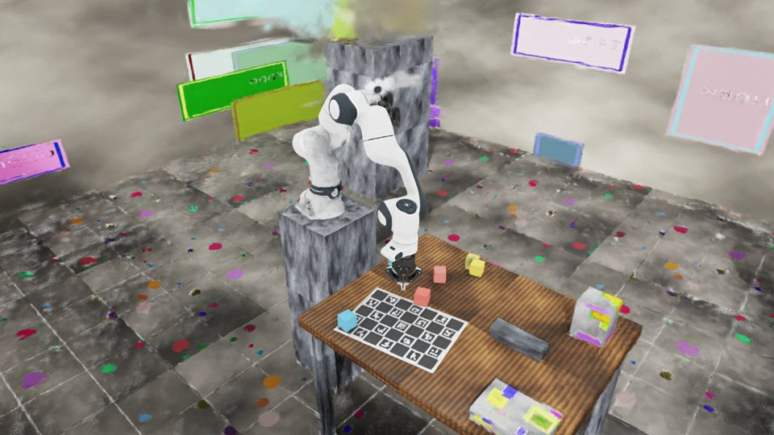

# Splat2Sim

Dockerized pipeline that turns a handheld RGB-D+IMU **Capture** (Luxonis OAK-D Pro W by default; RealSense D455 supported)
of a robot workcell into a **Scene**: a Gaussian-splat visual layer plus a collision layer that loads in Isaac Sim 6.1 /
Isaac Lab 3.0. On top of the Scene sits a **Task environment** with an FR3 arm, a Robotiq 2F-85 gripper and cubes, checked
by a scripted pick-and-lift. Vocabulary: [`CONTEXT.md`](CONTEXT.md).



<sub>Held-out frame of the public SLAM&Render mock Capture: splat render (left) vs ground truth (right).</sub>

## Pipeline



Every stage runs in its own container, writes into one run folder and leaves a `.done` marker, so reruns only redo what
changed. Details in [Architecture](docs/architecture.md).

| Ingest: depth over colour | Colliders over the splat | Pick-and-lift in the Task environment |
|---|---|---|
|  |  |  |

<sub>Left and middle: public mock Captures. Right: synthetic Capture.</sub>

## Status

| Stage | State | Notes |
|---|---|---|
| `ingest`, `mask`, `poses`, `anchor`, `splat`, `compose`, `report` | real (M1, on mock data) | ChArUco anchor, with gravity/plane fallback |
| `collision` | real (M2) | TSDF mesh, table/pedestal boxes, robot clearance |
| `env` | real (M2) | `Splat2Sim-FR3-Cubes-v0`, scripted pick-and-lift check |

Without a ChArUco board `anchor` writes `status: fallback` and `compose` aligns by gravity/dominant plane.

## Quickstart (workstation; only docker needed)

```bash
./r2s doctor                                   # docker, GPU, images, data dir, .env (secret values never printed)
./r2s build ~/real2sim-data/captures/x.mcap --lab robolab [--scene NAME] [--from STAGE] [--to STAGE] [--force STAGE]
./r2s status <scene>                           # per-stage pending / done / stale
./r2s view <scene>                             # stub
make test                                      # pytest inside the r2s-cli container
make build-images
```

Per-run options: `--quick` (3k-iteration splat), `--set poses.use_imu=false` (saved in `<run>/options.yaml`).
Environment: `R2S_DATA` (default `~/real2sim-data`), secrets in `$R2S_DATA/.env` (see `.env.example`).
More in [Architecture](docs/architecture.md). Shooting a Capture: [capture guide](docs/capture-guide.md), first run:
[first capture](docs/first-capture.md).

## Documentation

| Page | Covers |
|---|---|
| [Architecture](docs/architecture.md) | `r2s` launcher, containers, compose services, run folder, stages, staleness, repo layout |
| [Capture guide](docs/capture-guide.md) | How to shoot a Capture |
| [First capture](docs/first-capture.md) | First end-to-end run and how to read the report checks |
| [Ingest](docs/stages/ingest.md) | Capture formats, `frames/` outputs, keyframes, options |
| [Mask, poses, splat](docs/stages/poses-and-splat.md) | SLAM, 3DGRUT training, metrics, held-out renders |
| [Anchor](docs/stages/anchor.md) | ChArUco anchoring, frames, `anchor.json`, synthetic test |
| [Collision](docs/stages/collision.md) | TSDF mesh, table/pedestal fits, robot clearance, check |
| [Report](docs/stages/report.md) | Previews, checks, silhouette validation |
| [Task environment](docs/task-environment.md) | `Splat2Sim-FR3-Cubes-v0`, API, observations, actions |
| [Lab config](docs/lab-config.md) | `labs/<lab>.yaml` schema and adding a lab |
| [Synthetic capture](docs/synthetic-capture.md) | Ground-truth Capture generator and dry-run results |
| [Isaac image](docs/isaac-image.md) | Building the `isaac` service image |

## License

MIT, see [`LICENSE`](LICENSE).
