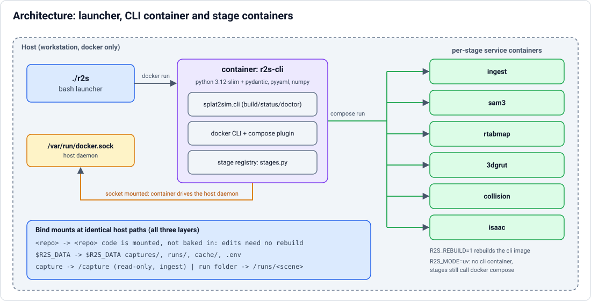
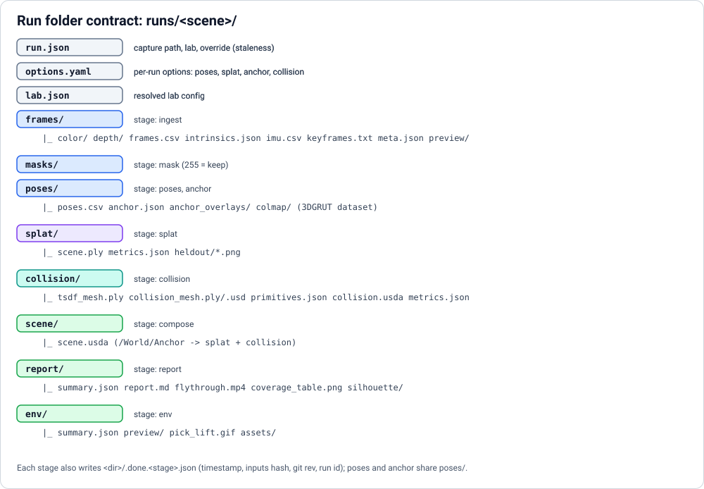
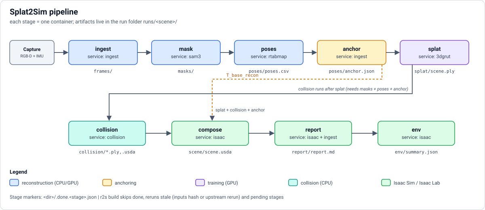

# Architecture

How the `r2s` launcher, its CLI container and the per-stage service containers fit together, what a run folder contains,
and how stages are skipped or rerun. Back to the [README](../README.md).



## Launcher and containers

`./r2s` runs the CLI in the `r2s-cli` container (python:3.12-slim + pydantic/pyyaml/numpy, built on first use) with the
docker socket, the host `docker` binary + compose plugin, the repo and the data dir mounted **at identical host paths**
(the container drives the host daemon, so bind-mount paths must match). The repo is mounted, not baked in: code edits need
no rebuild. `R2S_REBUILD=1 ./r2s ...` rebuilds the image.

Alternative without the container: `R2S_MODE=uv ./r2s ...` (or `uv run r2s ...`), needs `uv` and Python 3.12 on the host;
stages still call `docker compose`.

Environment: `R2S_DATA` (default `~/real2sim-data`, a historical name kept so existing data keeps working), secrets in
`$R2S_DATA/.env` (see `.env.example`; passed with `env_file`, never in images).

Commands:

| Command | Purpose |
|---|---|
| `./r2s doctor` | docker, GPU, images, data dir, .env (secret values never printed) |
| `./r2s build <capture> --lab <lab> [--scene NAME] [--from STAGE] [--to STAGE] [--force STAGE]` | run stages |
| `./r2s status <scene>` | per-stage pending / done / stale |
| `./r2s view <scene>` | stub |
| `make test` | pytest inside the `r2s-cli` container |
| `make build-images` | build the service images |

Per-run options: `r2s build ... --quick` (3k-iteration splat) and `--set poses.use_imu=false` (saved in
`<run>/options.yaml`; sections `poses`, `splat`, see `splat2sim/recon/options.py`).

## Repo layout

```
r2s                  host launcher (bash)
compose.yaml         services: r2s-cli, isaac, ingest (real); sam3 rtabmap colmap 3dgrut collision (placeholders, profile "todo")
docker/<service>/    Dockerfile per service (isaac/scripts is mounted into the isaac container)
labs/<lab>.yaml      per-lab config
splat2sim/           config.py (schema+merge) runfolder.py (contract) stages.py (registry) cli.py
tests/
spikes/isaac-smoke/  Isaac Sim 6.1 smoke-test scripts
```

## Run folders



```
~/real2sim-data/runs/<scene>/{frames,masks,poses,splat,collision,scene,report}   (+ env/, run.json)
```

## Stages



Order: `ingest -> mask -> poses -> anchor -> splat -> collision -> compose -> report -> env`
(`splat2sim/stages.py` maps each to a compose service + command and lists dependencies).

| Stage | Service | Page |
|---|---|---|
| `ingest` | `ingest` | [Ingest](stages/ingest.md) |
| `mask`, `poses`, `splat` | sam3, rtabmap, 3dgrut | [Mask, poses, splat](stages/poses-and-splat.md) |
| `anchor` | `ingest` | [Anchor](stages/anchor.md) |
| `collision` | `collision` | [Collision](stages/collision.md) |
| `compose`, `report` | `isaac` (+ `ingest` for the CPU report step) | [Report](stages/report.md) |
| `env` | `isaac` | [Task environment](task-environment.md) |

## Markers and staleness

* On success a stage writes `<dir>/.done.<stage>.json` (timestamp, inputs hash, git rev, run id). `poses` and `anchor`
  share `poses/`, hence per-stage marker names.
* Inputs hash = capture fingerprint (ingest only) + the lab-config sections the stage uses + the run ids of its
  dependencies. `r2s build` skips a stage whose marker matches (`done`), reruns `stale` ones (inputs changed, or an
  upstream stage was rerun) and `pending` ones.
* `--force STAGE` (repeatable) clears that marker and reruns it; downstream stages become stale automatically.
* `--dry-run` prints the `docker compose run` commands. Stub stages exit with code 3 and "not implemented yet".
* `run.json` records capture path, lab and override so `r2s status` can compute staleness.

## Tests

`make test` runs pytest in `r2s-cli`; tests that need extra libraries (cv2, mcap, scipy) skip there and run in the
service images, see the stage pages.
