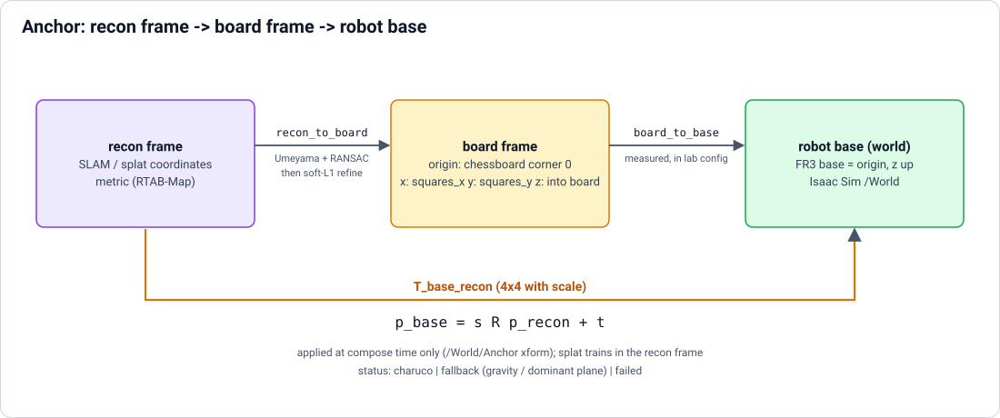
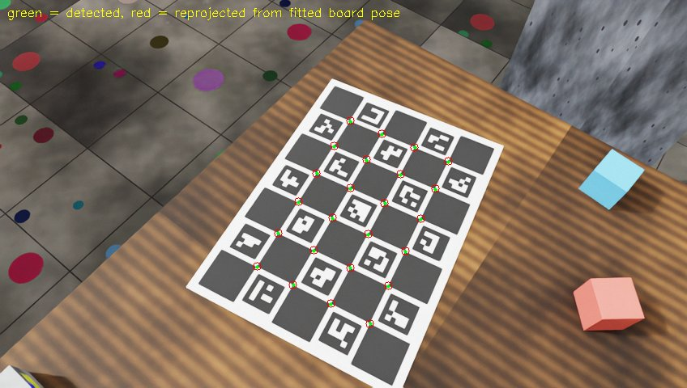

# Anchor stage

Detects the ChArUco board and fits the similarity transform recon frame -> robot base, applied at compose time. Follows
`poses` ([Mask, poses, splat](poses-and-splat.md)); used by [Collision](collision.md) and `compose`
([Report](report.md)).

`./r2s build ... --to anchor`

## Method

Service `ingest` (python:3.12-slim + opencv-contrib 4.10 + scipy; `python -m splat2sim.anchor anchor`, package
`splat2sim/anchor/`). Detects the ChArUco board (`charuco` in the [lab config](../lab-config.md)) in the posed frames of
`poses/poses.csv` (colour intrinsics, up to 400 evenly spaced frames), back-projects each corner with the aligned depth
(5x5 median, corners on depth edges or without valid depth rejected), fits board -> recon with Umeyama (with scale) inside
RANSAC (4 cm inlier threshold), then refines scale, R, t by minimising the soft-L1 corner reprojection error over all
frames (plus a weak depth-consistency term). The result composes with `board_to_base` into recon -> robot base.

## `poses/anchor.json`

| Field | Meaning |
|---|---|
| `status` | `charuco` \| `fallback` \| `failed`, with `reason` |
| `scale`, `R`, `t` | (charuco) similarity parameters |
| `T_base_recon` | 4x4 with scale, `p_base = s R p_recon + t`; this is what `compose` and `usdutil.anchor_transform` read |
| `recon_to_board`, `board_to_base` | the two chained transforms |
| `frames_used`, corner counts, `ransac_inliers` | fit support |
| `reproj_rms_px` | corner reprojection RMS |
| `corner_3d_rms_mm` | depth-backprojected corners vs the board model, board mm |
| `scale_estimate`, `warnings` | scale is recon-units-to-metres: RTAB-Map is metric, so a deviation > 5 % warns (wrong `square_length_m`, detection or depth problem) |

`poses/anchor_overlays/` shows detected vs reprojected corners.

Statuses: `fallback` = no board seen (mock captures); `failed` = board seen but too few consistent frames or reprojection
RMS > 5 px. Both exit 0, and `compose` then uses the gravity/plane fallback (`/World/Anchor` carries
`r2s:anchor = "fallback"`; with a board it carries `"charuco"` plus the residuals as `r2s:anchor_*` attributes), so
board-less captures still build.

Options (`options.yaml` section `anchor`, or `--set anchor.fix_scale=true`): see `ANCHOR_DEFAULTS` in
`splat2sim/anchor/stage.py`.

## Where the anchor is applied

**At compose time only** (`/World/Anchor` xform; collision applies the same transform to its mesh, see
[Collision](collision.md)). `splat` trains in the recon frame, so it does not depend on `anchor`: 3DGUT is invariant to a
similarity, re-measuring `board_to_base` or fixing a board problem re-runs only the 1-minute anchor + compose instead of a
30 min training, and the splat, its COLMAP poses and the collision mesh stay in one common frame until the final
transform.

Board frame (`board_to_base`): origin at chessboard corner 0 (one square in from the board's outer corner), x along
`squares_x`, y along `squares_y` (down the printed face), z into the board.

## Synthetic test with ground truth

`python tests/synth_charuco.py <run-dir> --frames 80` writes a ChArUco Capture in the frames contract +
`poses/poses.csv` + `lab.json`; run the stage with `python -m splat2sim.anchor anchor --run <run-dir>` and score it with
`python tests/synth_charuco.py <run-dir> --eval`. Unit + end-to-end tests: `tests/test_anchor.py` (need cv2/scipy: run in
the `r2s-ingest` image). A full synthetic Capture is described in [Synthetic capture](../synthetic-capture.md).
