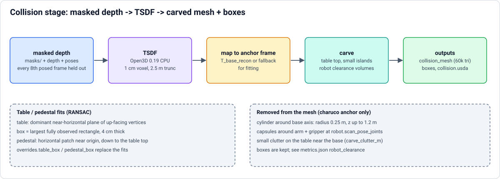
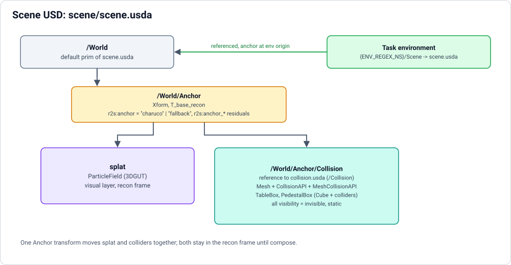
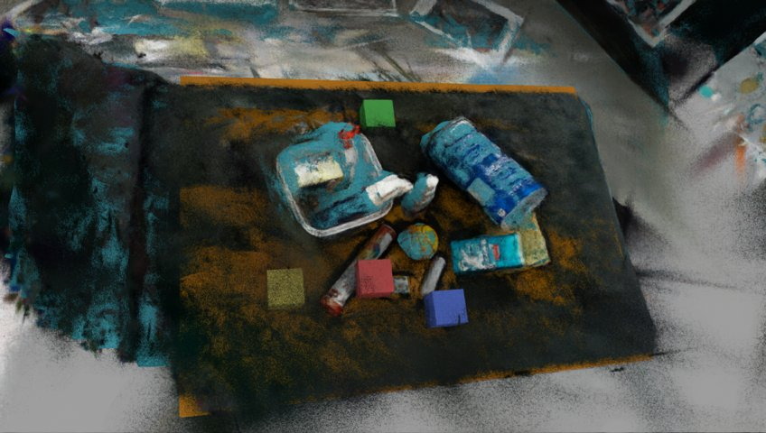
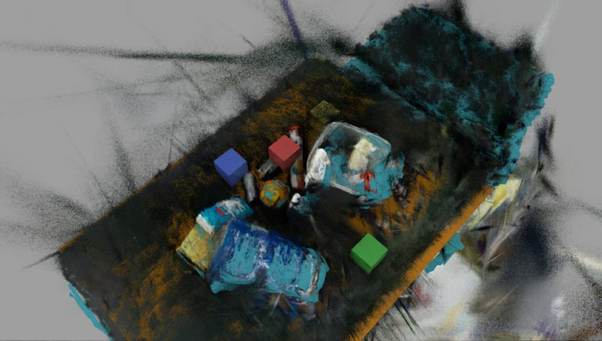

# Collision stage

Builds the collision layer: a TSDF mesh of the masked depth, a table box and a pedestal box, with the robot's own volume
carved out. Uses [Anchor](anchor.md) for the frame; its output is referenced by `compose` (see
[Task environment](../task-environment.md)).

`./r2s build ... --to collision`

## Method

Service `collision` (`docker/collision`, python:3.12-slim + Open3D 0.19.0 CPU + usd-core; separate from the Isaac image
because it needs no GPU/Isaac and a small image rebuilds in a minute; Open3D is pinned because 0.20.0's
`ScalableTSDFVolume` extracted empty meshes). Masked depth (`masks/`, 255 = keep) from frames that have poses is integrated
into a TSDF (1 cm voxel, depth truncated at 2.5 m, every 8th posed frame held out) in the **recon frame**; the mesh is
mapped into the anchor frame (`poses/anchor.json` when `status == "charuco"` (`T_base_recon`), else
`fallback_anchor.json`, the same choice as compose) for fitting.

| Output in `collision/` | Content |
|---|---|
| `tsdf_mesh.ply` | raw TSDF mesh |
| `collision_mesh.ply` / `.usd` | table top carved out, islands < 100 triangles dropped, decimated to 60k |
| `primitives.json` | `table_box`, `pedestal_box`: center, size, rpy_deg/yaw_deg in the anchor frame = world, `source` = ransac \| override \| absent, fit stats |
| `collision.usda` | USD layer (below) |
| `metrics.json` | held-out depth-to-collision error, plane RMS, coverage; copied into `report/summary.json` |

## Table and pedestal

* Table: dominant near-horizontal plane of the up-facing mesh vertices (RANSAC), box = largest fully observed rectangle in
  that plane (`table_extent: bounding` for the min-area rectangle), top face on the plane (follows its tilt;
  `table_level: true` for roll = pitch = 0), 4 cm thick. With the ChArUco anchor the plane is searched in z in
  [-0.5, 0.3] m around the robot base; with the fallback anchor an elevated plane (>= 25 cm above the floor-like dominant
  plane, below the cameras) is preferred, because the fallback origin sits on the dominant plane (often the floor).
  Override with `table_z_range`.
* Pedestal: only with a ChArUco anchor (robot base = origin): the horizontal patch near the origin, extending down to the
  table top. Fallback anchor: `absent` unless `overrides.pedestal_box` is set. `overrides.table_box/pedestal_box` (lab
  config, rpy in degrees) replace the fits (`source: override`).

## USD layer

`collision.usda` (default prim `/Collision`, **recon frame**; compose references it at `/World/Anchor/Collision`, so one
Anchor transform moves splat and colliders): `Mesh` with `CollisionAPI` + `MeshCollisionAPI` (approximation `none`),
`TableBox` / `PedestalBox` as `Cube` prims with colliders; all `visibility = invisible`, no rigid bodies (static).

## Robot clearance

Charuco anchor only (robot base = origin): mesh triangles with a vertex inside a vertical cylinder around the base axis
(`clearance_radius_m` 0.25, from pedestal top + `clearance_z_margin_m` 0.02 up to `clearance_z_max_m` 1.2) or inside
capsules around the arm + gripper at `robot.scan_pose_joints` (`clearance_arm`, `clearance_arm_radius_m` 0.10,
`clearance_gripper_length_m` 0.22; FK in `splat2sim/robot_fk.py`) are removed: mask leaks, dilation borders and cables
near the arm must not collide with the real robot. The boxes are kept. What was removed is in `metrics.json`
(`collision_mesh.robot_clearance`: counts, volume, bbox). Set defaults per lab in the [lab config](../lab-config.md)
(`collision:` section, same keys) or per run with `--set collision.clearance_radius_m=0.3`;
`--set collision.clearance=false` disables it. `carve_clutter_m` (0.12) / `carve_clutter_radius_m` (0.8) also drop small
things lying on the table near the base (the cubes of the Capture stay in the splat but must not become collision bumps
under the cubes the env spawns).

## Options

`--set collision.<key>=...`, defaults in `splat2sim/collision/stage.py`: `voxel_m`, `depth_trunc_m`,
`max_integrate_frames`, `target_triangles`, `table_extent`, `table_level`, `table_z_range`, `include_mesh` (false = boxes
only), `carve_table`, ...

## Check (Isaac, on demand)

`docker compose run --rm -e R2S_SCENE=<scene> isaac -p /workspace/r2s/collision_check.py` drops 4 rigid 5 cm cubes over
free spots of the table box in `scene.usda` (in memory only), writes `collision/check.json` (rest height above the table
plane, pass if within 1 cm) and previews (`preview_cubes.png`, `preview_debug_*.png` with the colliders made visible over
the splat).

| Wide | Top |
|---|---|
|  |  |

## Fallback-aligned scenes

With a fallback-aligned scene there is no robot at the origin: the mesh (floor, walls) can intrude on the arm and the
fitted table is outside its reach, so the `env` stage needs a ChArUco anchor (or `overrides.table_box` plus
`--set collision.include_mesh=false`).
