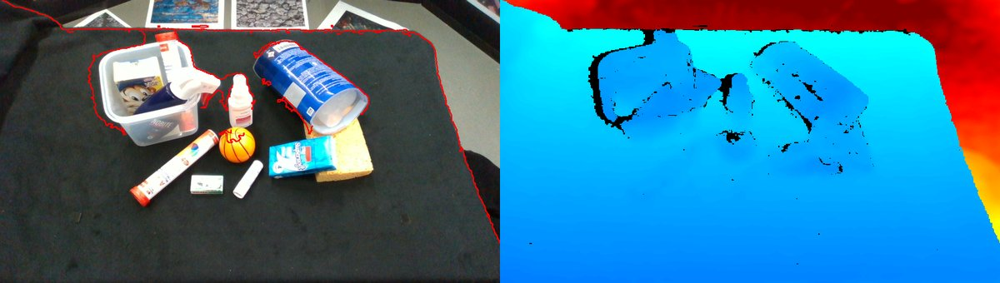

# Ingest stage

Converts a Capture (MCAP, librealsense bag, frames folder or TUM folder) into the `frames/` contract: aligned colour +
depth, IMU, keyframes and preview overlays. See [Architecture](../architecture.md) for how stages run.

`./r2s build <capture> --lab robolab --to ingest`

Service `ingest` (`docker/ingest`, python:3.12-slim + rosbags/mcap/mcap-ros2-support/opencv-headless; no ROS). The
`splat2sim/` package is bind-mounted (no rebuild on code edits); `r2s build` mounts the capture read-only at `/capture`
and runs the container as your uid. Format is autodetected (magic bytes / folder layout):

| Capture | Reader notes |
|---|---|
| ROS 2 MCAP, RealSense (`R2S_CAMERA=realsense`; file or rosbag2 dir) | topics found by suffix (`*/color/image_raw`, `*/aligned_depth_to_color/image_raw`, `*/imu` or `*/gyro/sample`+`*/accel/sample`, camera_info, `/tf_static`). Aligned depth is used; if absent, raw `*/depth/image_rect_raw` is registered to colour with camera_info + the `extrinsics/depth_to_color` topic or `/tf_static`. |
| ROS 2 MCAP, OAK-D Pro W (default; `depthai_ros_driver_v3`) | topics `/oak/rgb/image_raw` (bgr8, on-device undistorted), `/oak/stereo/image_raw` (16UC1 mm, aligned to colour at colour size), `/oak/rgb/camera_info`, `/oak/imu/data` (united accel + gyro). Camera product / serial / firmware come from `capture_info.json` next to the MCAP. |
| librealsense `.bag` (ROS 1, e.g. Intel sample) | unaligned depth (1280x720) registered into the colour frame (z-buffer reprojection) with stored intrinsics/extrinsics; separate Accel/Gyro topics united by interpolation onto the faster stream. |
| `frames/` folder (synthetic, `tools/synth_capture`) | `color/ depth/ frames.csv intrinsics.json [gt_poses.csv, metres]`: copied through the ingest contract (reader `frames_reader.py`). |
| TUM folder (SLAM&Render): `rgb/ depth/ associations.txt imu.txt groundtruth.txt` | depth assumed aligned, 16-bit mm (`--depth-factor` for other units). **Intrinsics are not in the folder**: give them in `<capture>/intrinsics.yaml|json` or in `runs/<scene>/ingest.yaml` (`intrinsics: path`, relative paths resolve in the run folder). Without either, nominal D435 values are used and flagged (`intrinsics.json` `source`). The dataset's Drive index lists only the 40 zips, not `intrinsics.yaml`. |

## Output: `runs/<scene>/frames/`

| File | Content |
|---|---|
| `color/NNNNNN.png` | 8-bit RGB |
| `depth/NNNNNN.png` | uint16 mm, aligned to colour, 0 = invalid |
| `frames.csv` | index, timestamp_ns, color, depth, sharpness |
| `intrinsics.json` | fx fy cx cy width height distortion_model distortion_coeffs depth_scale_m=0.001 source; always a **pinhole** (see below) |
| `imu.csv` | timestamp_ns, gx gy gz [rad/s], ax ay az [m/s^2]; clipped to the frame range +-0.5 s |
| `keyframes.txt` | indices downstream stages should use |
| `gt_poses.csv` | when present (OptiTrack, **translation in mm**, not converted) |
| `meta.json` | format, source, serial/firmware if recorded, durations, frame/IMU rates, dropped/gap stats, depth validity |
| `preview/overlay_*.png` | depth edges over colour + colourised depth: eyeball the alignment |

## Pinhole invariant

Every stage after ingest (RTAB-Map, the COLMAP `PINHOLE` writer, TSDF, silhouettes) assumes an undistorted pinhole camera.
If `camera_info` still carries distortion (plumb_bob or rational 8/12/14 coefficients), ingest undistorts colour (bilinear)
and depth (nearest) to a pinhole K without black borders (`splat2sim/ingest/undistort.py`) and records
`undistorted_in_ingest: true` plus the original model in `intrinsics.json` / `meta.json`. The OAK default undistorts on the
device, so its frames pass through unchanged.

## Keyframes and options

All frames are always written; `keyframes.txt` lists the indices downstream stages should use.
Options (CLI `python -m splat2sim.ingest ingest --help`, or `runs/<scene>/ingest.yaml` with the same keys, which is part of
the stage's inputs hash):

| Option | Meaning |
|---|---|
| `every: N` | keep every N-th frame |
| `min_sharpness: T` | variance of the Laplacian; with `every` the sharpest frame in each window is taken |
| `format` | force the Capture format |
| `intrinsics` | path to intrinsics file |
| `depth_factor` | depth units for TUM folders |
| `depth_mode: auto\|aligned\|register` | how depth is brought into the colour frame |
| `max_frames` | cap on frames |

## Tests

`make test` (r2s-cli; ingest unit tests needing cv2/mcap skip there). Full run in the ingest image:
`docker run --rm -v $PWD:/repo -w /repo -e PYTHONPATH=/repo --entrypoint python r2s-ingest:latest -m pytest -q tests`.

Next: [Mask, poses, splat](poses-and-splat.md).
