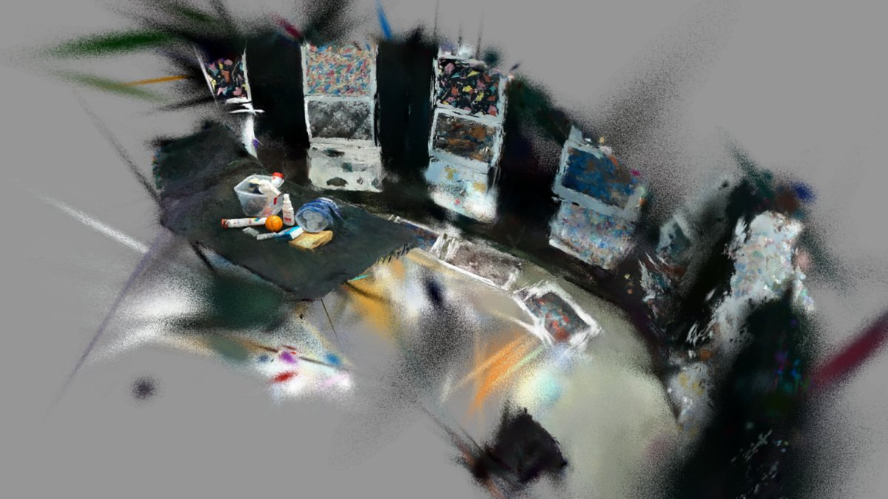

# Mask, poses and splat stages

Per-frame robot masks, SLAM poses and Gaussian-splat training, plus the metrics and held-out renders they produce.
Preceded by [Ingest](ingest.md), followed by [Anchor](anchor.md) and [Collision](collision.md).

| Stage | Service | Output |
|---|---|---|
| `mask` | sam3 | `masks/` (255 = keep) |
| `poses` | rtabmap | `poses/poses.csv`, `poses/colmap/` |
| `splat` | 3dgrut | `splat/` |

## Poses

SLAM runs at ~10 fps (`poses.every: auto`: stride 3 on 30 fps; full rate takes >1 h on the 98 s mock capture).
`poses/colmap/` holds the 3DGRUT dataset (`sparse/0/*.txt`, `images/`). Options: `--set poses.use_imu=false`, saved in
`<run>/options.yaml` (see `splat2sim/recon/options.py`).

## Splat

`splat` trains in the recon frame, so it does not depend on `anchor` (see [Anchor](anchor.md)). 30k iterations on the
3090 Ti take ~26 min (about 1M Gaussians); `--quick` (3k) gives ~20 dB in ~2 min.

## Metrics and held-out renders

`splat/metrics.json` holds the held-out PSNR/SSIM/LPIPS from 3DGRUT's `metrics.json` (mean over the test split), gaussians,
wall time and whole-GPU VRAM peak. `splat/heldout/*.png` are [render | ground truth] pairs:

The resulting splat, rendered from the `report` stage:

Ground-truth-checked numbers on the synthetic Capture are in [Synthetic capture](../synthetic-capture.md).
