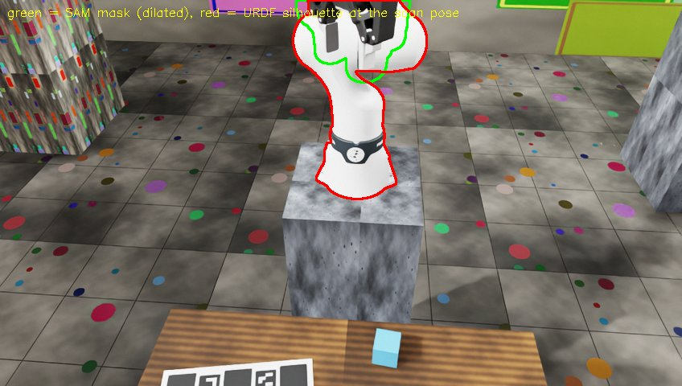

# Report stage

Previews, a fly-through video and a list of leveled checks that tell you whether a Scene is good enough. Follows
`collision`/`compose` ([Collision](collision.md)); how to act on the checks is explained in the
[first capture](../first-capture.md) guide.

`./r2s build ... --to report`

## Steps

Three steps (`Stage.post` in `splat2sim/stages.py`):

1. `docker/isaac/scripts/report.py`: previews + fly-through PNG frames.
2. `robot_silhouette.py` (Isaac Lab): the robot alone at `robot.scan_pose_joints` rendered from 24 keyframe cameras after
   the ChArUco anchor, `report/silhouette/sil_*.png`.
3. `python -m splat2sim.report finish` in the **ingest** image (CPU; `imageio-ffmpeg` there encodes `report/flythrough.mp4`
   because the Isaac image has no ffmpeg backend).

## Outputs

| File | Content |
|---|---|
| `report/summary.json` | all numbers and check results |
| `report/report.md` | verdict, headline numbers, all checks with levels `ok\|warn\|redo\|fix`, previews |
| `flythrough.mp4` | camera fly-through of the Scene |
| `coverage_table.png` | table-top view counts |
| `silhouette_overlay_*.png` | SAM mask vs URDF silhouette |

Checks and thresholds: `splat2sim/report/summary.py` (`THRESH`), explained in [first capture](../first-capture.md).

* `mask_vs_urdf` = SAM masks vs the URDF silhouette (fraction of the silhouette inside the mask, IoU against the dilated
  silhouette): it validates `board_to_base`, the scan pose and the mask together.
* `table_coverage` = fraction of the fitted table top seen (depth-consistent) from >= 1/3/5 keyframes.

The `env` stage re-runs the CPU step so `report/` also carries the pick-and-lift result and the reset safety check
([Task environment](../task-environment.md)).
