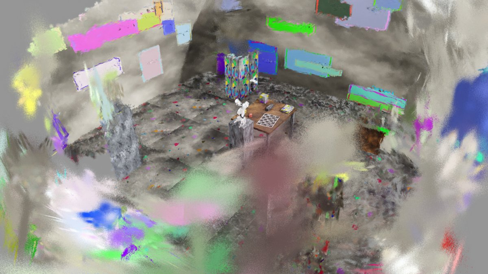

# Synthetic capture with ground truth

A generator that renders a handheld-like Capture of the FR3 workcell in Isaac Sim, with exact poses, masks and board
placement, so every stage can be scored against the truth. Feeds the normal pipeline through the `frames/` contract
([Ingest](stages/ingest.md)).

`tools/synth_capture/run.sh --frames 600 --out /captures/synth-robot` renders (Isaac Sim, ~2.5 min on the 3090 Ti) a
handheld-like walk around the FR3 + 2F-85 on a pedestal, a table with the ChArUco board (true `board_to_base` in
`labs/synth.yaml`), 3 cubes, clutter and a textured room, in the `frames/` contract with `gt_poses.csv`,
`gt/robot_mask/` and `synth_gt.json`.

`./r2s build $R2S_DATA/captures/synth-robot --lab synth --scene synth-robot` runs the whole pipeline on it;
`tools/synth_capture/evaluate.py` scores anchor / masks / boxes against the truth (see the file header).

## Dry-run results

3090 Ti, 600 frames 848x480, `--quick`, ~11 min end to end:

| Check | Result |
|---|---|
| SLAM ATE | 3-4 mm |
| Anchor | 1.4 px reprojection; 7 mm mean / 13 mm max placement error over the workcell vs the best Sim(3) of the SLAM trajectory (0.33 deg, scale 0.990 vs 0.999) |
| Table box | top +8 mm, footprint IoU 0.96 |
| SAM vs the rendered robot | 85 % of its pixels covered (IoU 0.82 vs the dilated truth) |
| URDF silhouette inside the mask | 1.00, IoU 0.93 |
| Splat | 24.9 dB at 3k iterations |
| Pick-and-lift, mesh + clearance | 3/5 |
| Pick-and-lift, boxes only | 3/5 |
| Pick-and-lift, **mesh without clearance** | **0/5** (mesh touches link 0-2 and the fingers at reset; the safety check reports it) |
| Pick-and-lift, robot left in the mesh (no masks) | 0/5 without, 3/5 with the clearance volume |

See [Collision](stages/collision.md) for the clearance volume and [Task environment](task-environment.md) for the check.
