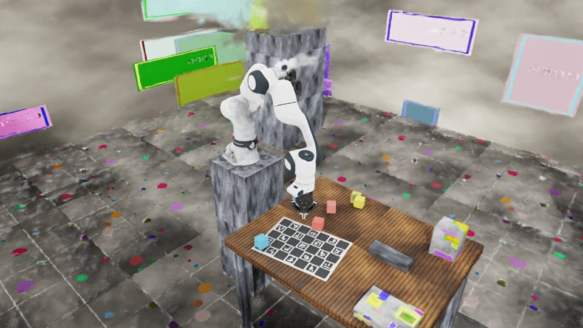
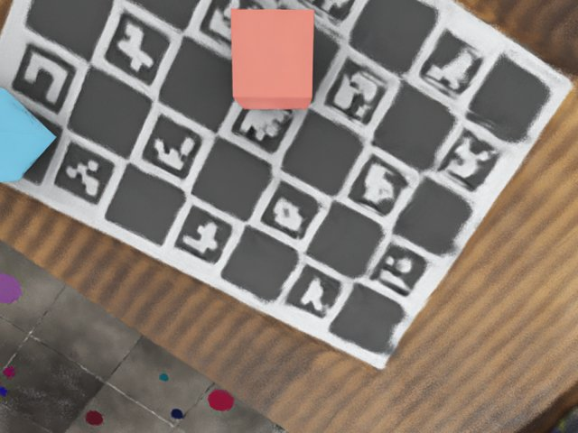
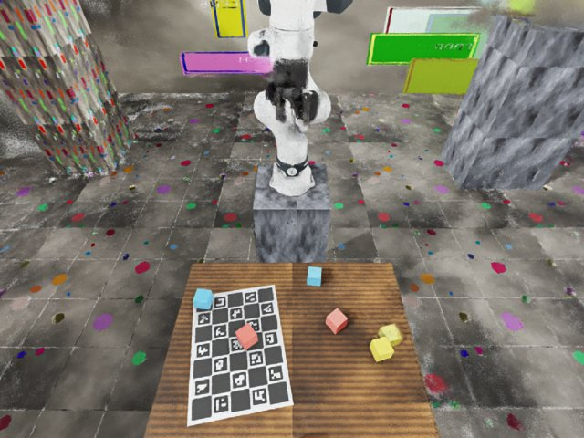
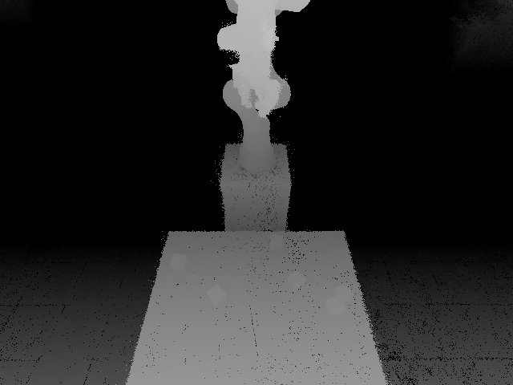

# Task environment

The `env` stage and the Isaac Lab environment `Splat2Sim-FR3-Cubes-v0`: FR3 + Robotiq 2F-85 and cubes standing in the
generated Scene, with a scripted pick-and-lift check. Needs a Scene from [Collision](stages/collision.md) /
`compose`, and the `policy_cameras` / `cubes` sections of the [lab config](lab-config.md).



Code: `splat2sim/lab/` (mounted into the isaac container with the rest of `splat2sim/`, importable by training code),
`docker/isaac/scripts/check_env.py` (the stage). `geometry.py` is pure numpy (tests: `tests/test_lab_env.py`); `asset.py`,
`env_cfg.py`, `mdp.py`, `scripted.py` need Isaac Lab.

## Components

| Part | Description |
|---|---|
| Robot (`asset.py`) | `fr3.usd` with its Franka hand deactivated + the bundled `Robotiq_2F_85_edit.usd` (same file and `Physx_Mimic` variant NVIDIA's Panda variant uses), joined by a fixed joint `fr3_link8 -> base_link` carrying `robot.coupling_offset`. Built once into `<run>/env/assets/fr3_robotiq_2f85-<hash>.usda` (hash = coupling offset + asset URLs; references the remote 6.1 assets). Actuators are cloned from Isaac Lab's `FRANKA_ROBOTIQ_GRIPPER_CFG` (`finger_joint` driven K=17 D=0.02, `.*_inner_finger_joint`, passive knuckles with zero gain, `right_outer_knuckle_joint` mimic from the USD); deviations: `fr3_joint*` names, FR3 velocity limits (2.62 / 5.26 rad/s), home pose = `robot.scan_pose_joints`, base at the world origin. The bundled 2F-85 grasped 5 cm cubes fine, so the UWLab calibrated gripper was not needed. |
| Scene | `<run>/scene/scene.usda` is referenced at `{ENV_REGEX_NS}/Scene` (anchor at the env origin). The table the cubes rest on is a static collider from `read_table_box()` (`collision/primitives.json` -> `overrides.table_box` -> default 1.2 x 0.8 m at z = 0), added unless `scene.usda` already references the collision layer; it is invisible with a Scene (the splat is the visual), visible without one (`show_table`). |
| Cubes | `cubes` cfg, re-sampled every reset inside the table box shrunk by `env.spawn_margin_m` and clipped to `env.reach_min_m..reach_max_m` from the base (`env` lab section, optional), non-overlapping, random yaw. |
| Cameras | `wrist` (child of `fr3_link8`) and `front` (child of `fr3_link0`), RGB + `distance_to_image_plane`, poses/intrinsics from `policy_cameras` with Isaac Lab's `"world"` offset convention (+x forward, +z up == the lab-config frame). `check_env` projects every cube through the configured pose + FOV and compares with the cube's colour centroid in the render (`summary.json:camera_check`; 0.2-2.8 px on the no-scene run). |

Scene layers: see [Collision](stages/collision.md#usd-layer).

## API

Manager-based `ManagerBasedRLEnv`, 30 Hz control (120 Hz physics). Placeholder zero-weight reward, time-out only.

| | Name | Shape / unit |
|---|---|---|
| Action | absolute `fr3_joint1..7` targets | 7, rad |
| Action | `finger_joint` target | 1, rad (0 open, ~0.4 closed on a 5 cm cube, limit 0.82); total `(num_envs, 8)` |
| Obs `policy` | `joint_pos` | 8 |
| Obs `policy` | `joint_vel` | 8 |
| Obs `policy` | `cube_pos` | 3n |
| Obs `policy` | `cube_quat` | 4n, xyzw |
| Obs `policy` | `wrist_rgb`, `front_rgb` | (480, 640, 3) float 0..1 |
| Obs `policy` | `wrist_depth`, `front_depth` | (480, 640, 1) m |

The `policy` group is a dict, not concatenated.

```python
from splat2sim.lab.env_cfg import Splat2SimFR3CubesEnvCfg       # inside launch_simulation(...), after cfg.ensure_robot_asset()
cfg = Splat2SimFR3CubesEnvCfg.from_lab("/runs/<scene>/lab.json", "/runs/<scene>", num_envs=1)   # or gym.make(ENV_ID) with $R2S_SCENE/$R2S_LAB
env = gym.make("Splat2Sim-FR3-Cubes-v0", cfg=cfg)
```

| Wrist RGB | Front RGB | Front depth |
|---|---|---|
|  |  |  |

## The check

`./r2s build <capture> --lab robolab --scene S --from env --to env` runs `check_env.py`: 5 resets, each a scripted pick
(`scripted.py`: Lab's differential IK to a top-down TCP pose above the cube, descend, close, lift 10 cm, hold 1 s).
Success = cube centre >= 8 cm above its rest height for the whole hold and within 5 cm of the TCP. Writes
`env/summary.json` (success rate, per-trial numbers, obs/action shapes, timings, VRAM), `env/preview/{wrist,front}_{rgb,depth}_*.png`,
`overview_*.png`, `pick_lift.gif` (no mp4: the Isaac image has no ffmpeg backend for imageio). Exit code 1 below
`--min-success` (0.6). Direct run:
`docker compose run --rm -e R2S_SCENE=S isaac -p /workspace/r2s/check_env.py [--no-scene] [--trials N] [--out DIR] [--show-table]`.
The 6.1 assets come over `ISAACSIM_ASSET_ROOT` (HTTP cache in `cache/isaac/ov`). The `env` stage also re-runs the CPU
report step ([Report](stages/report.md)).

Results on the workstation (3090 Ti): 5/5 with the m1-demo Scene (table collider at z = 0, `overrides.table_box`
1.2 x 0.8 m), 8/8 and 5/5 without; ~11 env steps/s with two 640x480 policy cameras + an overview camera, ~6.5-7 GB
whole-GPU VRAM peak; a 1-env run takes ~5 min cold (shader/asset caches warm: ~25 s start + ~2.5 min trials).
